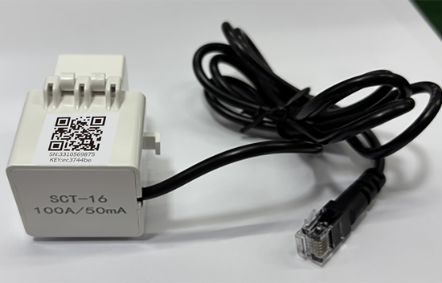
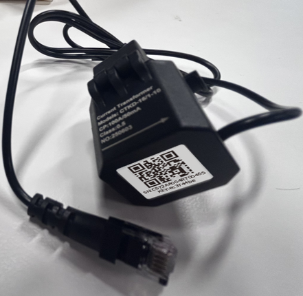
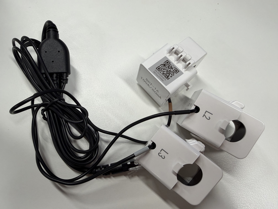
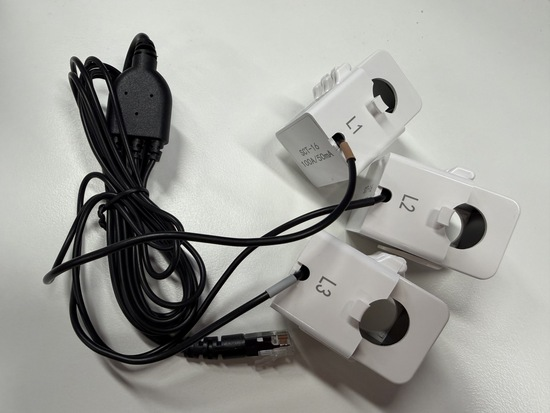
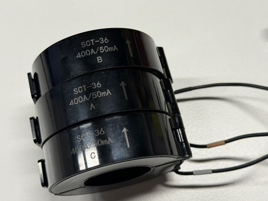
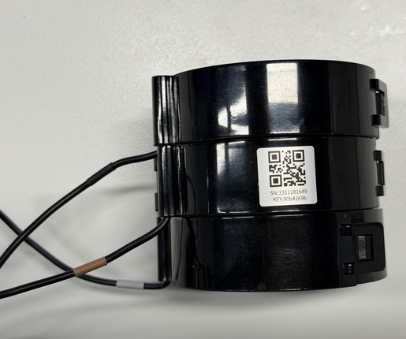

# Accessories

The D5 series uses split-core current transformers (CT) with an accuracy of **class 0.5**. Single-phase models use the 100 A specification; three-phase models use 100 A or 400 A, see [Parameter Comparison](../parameter-comparison.md).

| Meter | CT specification | Photo 1 | Photo 2 |
| --- | --- | --- | --- |
| Single-phase meter | 100 A / 50 mA, two 100 A form factors shipped at random |  |  |
| Three-phase meter | 100 A / 50 mA |  |  |
| Three-phase meter | 400 A / 50 mA |  |  |
