# Appearance, Interfaces and Indicators

## MR1-D5-W Appearance

| Left view | Front view | Right view |
| --- | --- | --- |
| 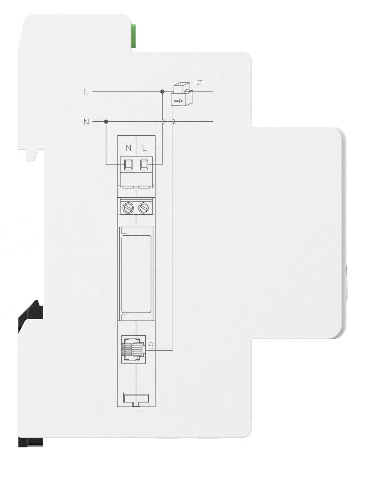 | 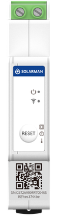 | 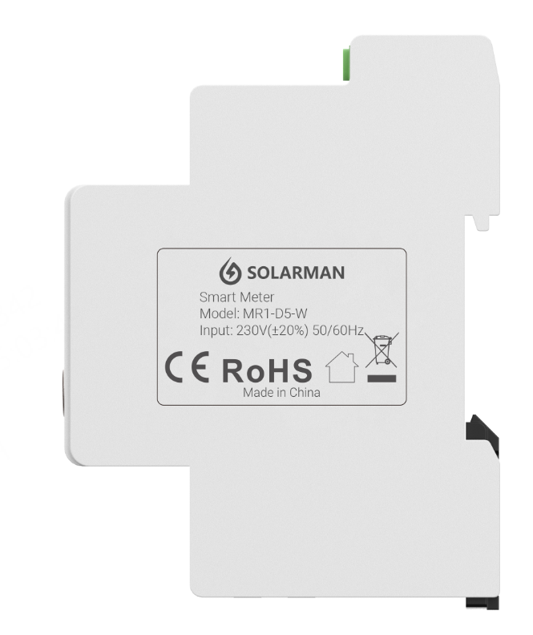 |

| Top view | Back view | Bottom view |
| --- | --- | --- |
| 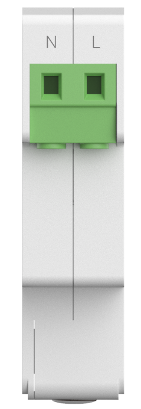 | 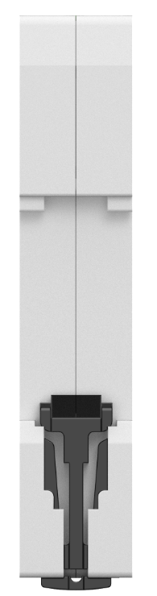 | 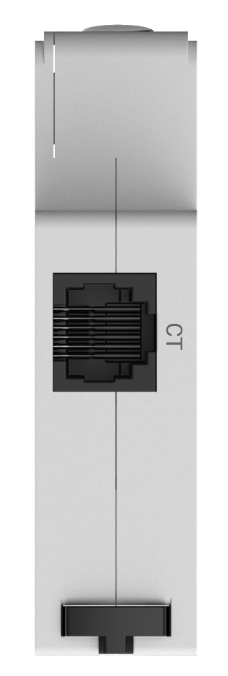 |

## MR1-D5-WR Appearance

| Left view | Front view | Right view |
| --- | --- | --- |
| 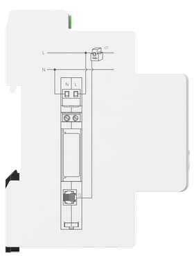 | 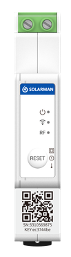 | 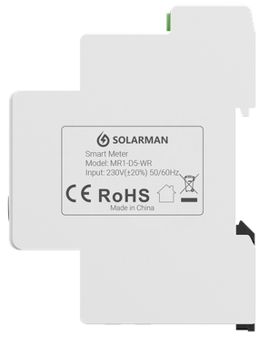 |

| Top view | Back view | Bottom view |
| --- | --- | --- |
| 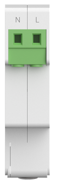 | 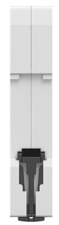 | 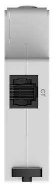 |

## MR3-D5-W Appearance

| Left view | Front view | Right view |
| --- | --- | --- |
| 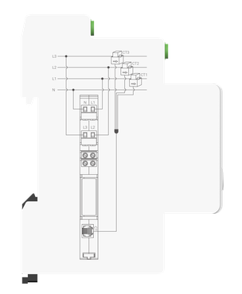 | 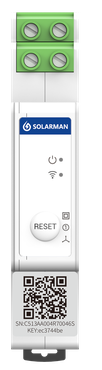 | 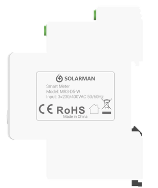 |

| Top view | Back view | Bottom view |
| --- | --- | --- |
| 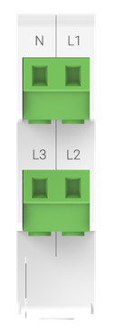 | 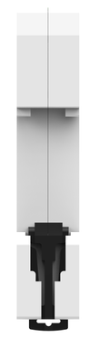 | 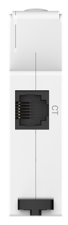 |

## MR3-D5-WR Appearance

| Left view | Front view | Right view |
| --- | --- | --- |
| 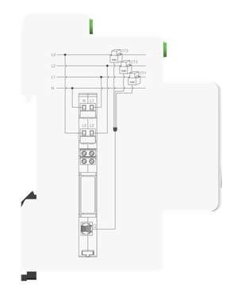 | 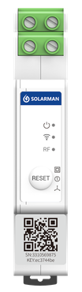 | 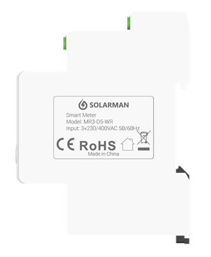 |

| Top view | Back view | Bottom view |
| --- | --- | --- |
|  |  |  |

## Interface Definition

| Marking | Description | Models |
| --- | --- | --- |
| N | Neutral input terminal. | Single-phase and three-phase models |
| L | Single-phase live input terminal. | MR1-D5-W, MR1-D5-WR |
| L1, L2, L3 | Three-phase live input terminals. | MR3-D5-W, MR3-D5-WR |
| CT | Current transformer interface. | Single-phase and three-phase models |

## Indicators

| Marking | Indicator | Models | Status |
| --- | --- | --- | --- |
|  | Power (red) | All models | Steady on: power supply normal. Off: no power supply or abnormal supply. |
|  | Network Wi-Fi (green) | All models | Steady on: connected to the cloud platform. Blinks every 1 s: router connected or IP address obtained. Blinks every 100 ms: device is upgrading. Off: router not connected or no IP address obtained. |
| 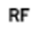 | LoRa (green) | MR1-D5-WR, MR3-D5-WR | Steady on: LoRa connected. Off: LoRa not connected or not enabled. |

## RESET Button

| Marking | Operation | Status |
| --- | --- | --- |
|  | Long press for 10 s to restore factory settings. | All indicators stay on for 2 s, then return to normal. |
