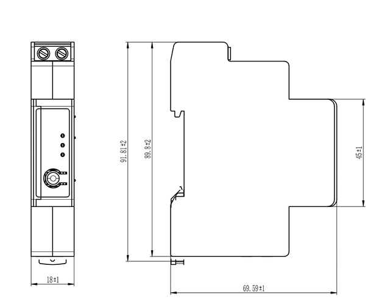
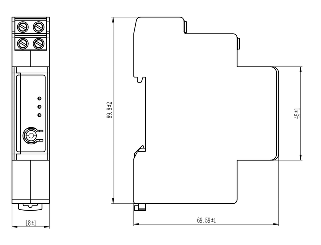

# Product Structure

Dimensions are in **mm**, with a dimensional accuracy of **±2%**.

## Single-Phase Meter

Applies to MR1-D5-W and MR1-D5-WR.

## Three-Phase Meter

Applies to MR3-D5-W and MR3-D5-WR.

