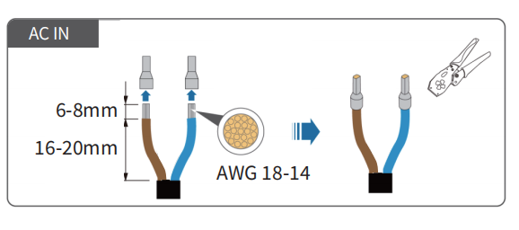
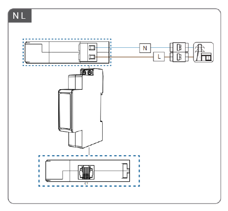
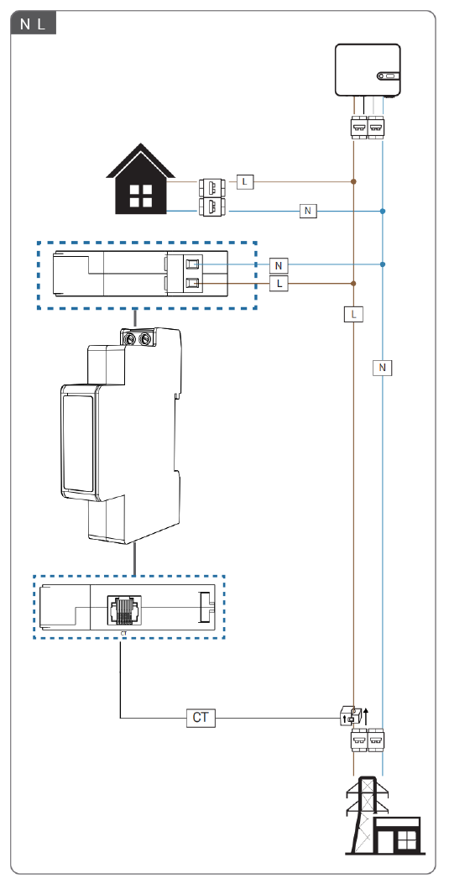
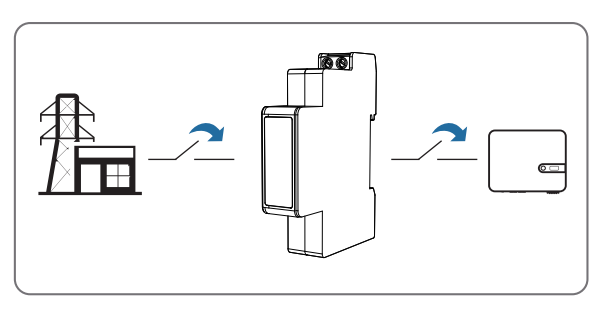

# Single-Phase Wiring

Applies to **MR1-D5-W, MR1-D5-WR**. Complete the [installation preparation](wiring.md) first.

:::warning Warning
The power must be completely disconnected and verified de-energized before wiring.
:::

## Electrical Wiring

1. Use wire strippers to strip 6–8 mm of insulation from the wire end, then crimp with a terminal matching the wire gauge.

   

2. Connect the neutral wire (N) and the live wire (L) to the meter terminals according to the terminal markings.

   

3. Pass the main live wire (L) through the CT aperture. Ensure the incoming power direction matches the P1 side marked on the CT, then connect the CT plug to the CT port on the meter.

   

4. Only restore power after all wiring is complete and has been double-checked. After power-on, check whether the power indicator stays on to confirm that the meter is powered.

   

After power-on, see [App Device Adding and Network Configuration](app-usage.md).
