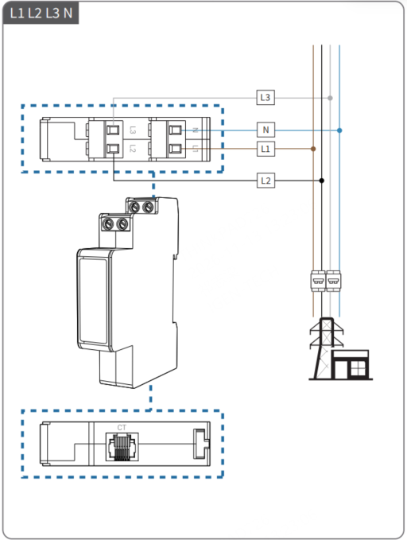
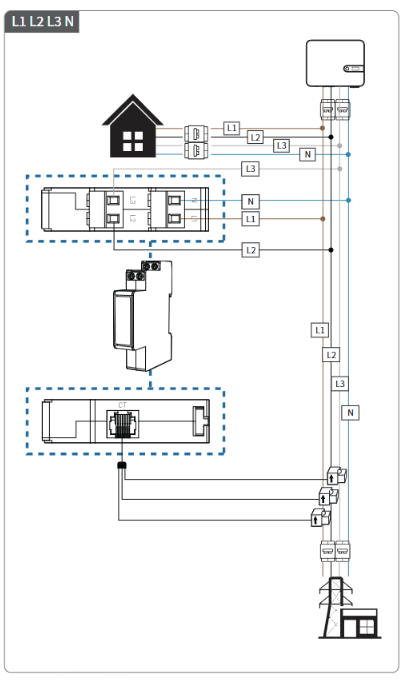
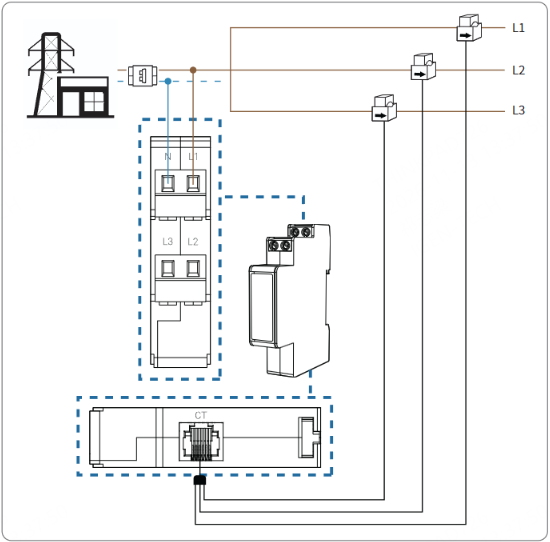
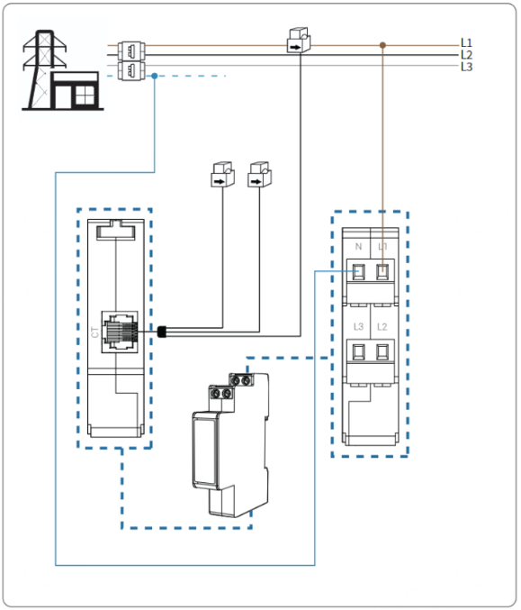
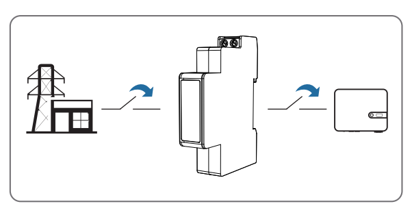

# Three-Phase Wiring

Applies to **MR3-D5-W, MR3-D5-WR**. Complete the [installation preparation](wiring.md) first.

:::warning Warning
The power must be completely disconnected and verified de-energized before wiring. The diagrams below correspond to different measurement scenarios; have a professional confirm the applicable diagram before installation.
:::

## Standard Three-Phase Wiring

1. Use wire strippers to strip 6–8 mm of insulation from the wire end, then crimp with a terminal matching the wire gauge.
2. Connect the neutral wire (N) and the three-phase live wires (L1, L2, L3) to the meter terminals according to the terminal markings.

   

3. Install the CTs according to the standard three-phase wiring diagram, check the phase correspondence between each CT and live wire, and make the incoming power direction match the P1 side marked on the CT. Connect the CT plugs to the CT ports on the meter.

   

## Other Measurement Scenarios

Each of the following scenarios has its own wiring diagram.

### Three-Channel Load Measurement on a Single-Phase System

### Single-Phase Measurement on a Three-Phase System

## Power-On Check

Only restore power after all wiring is complete and has been double-checked. After power-on, check whether the power indicator stays on to confirm that the meter is powered.

After power-on, see [App Device Adding and Network Configuration](app-usage.md).
