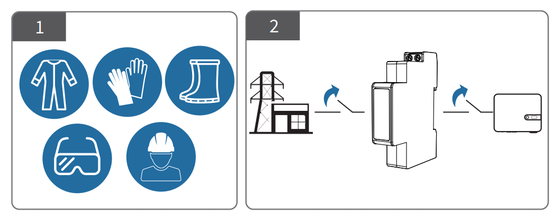
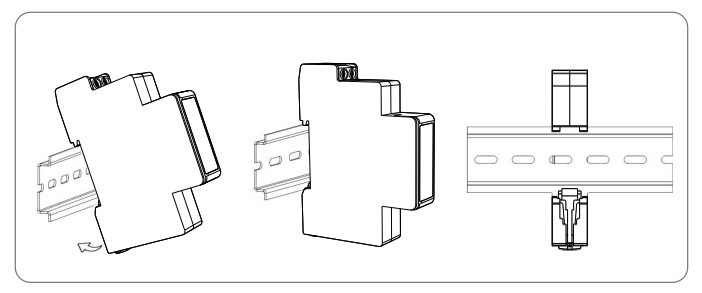

# Installation Preparation

Applies to MR1-D5-W, MR1-D5-WR, MR3-D5-W and MR3-D5-WR.

## Personnel and Protection

Installation must be carried out by experienced electricians or professionals. Before starting, read [Safety Instructions](../safety/safety-instructions.md), make sure the wiring requirements are understood, and wear dedicated protective equipment that meets the relevant safety standards.

:::warning Warning
All installation and wiring work must be carried out with the power completely disconnected and verified de-energized. Installing or wiring while energized is strictly prohibited.
:::

## Mechanical Installation

1. Based on the [meter dimensions](../overview/product-structure.md), choose the mounting position on the 35 mm standard DIN rail in the distribution box, leaving room for wiring and maintenance. The distribution box should be equipped with a suitable surge protective device (SPD).
2. Align the slot on the back of the meter with the top edge of the rail, then press down until the bottom latch is securely locked onto the rail.

## Choosing a Wiring Section

- MR1-D5-W, MR1-D5-WR: [Single-Phase Meter Installation and Wiring](single-phase-wiring.md).
- MR3-D5-W, MR3-D5-WR: [Three-Phase Meter Installation and Wiring](three-phase-wiring.md).
