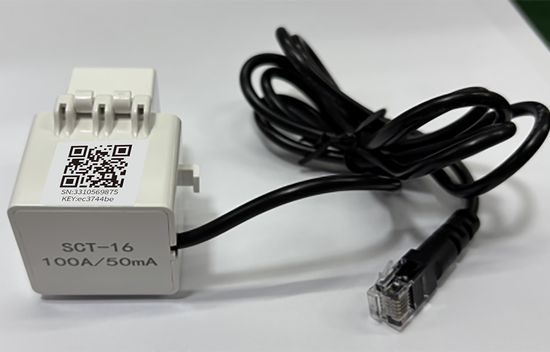
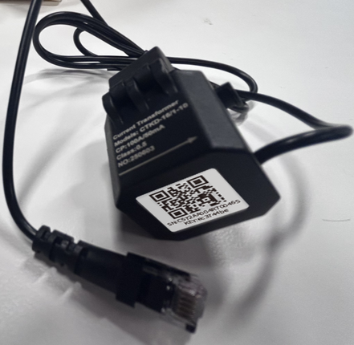
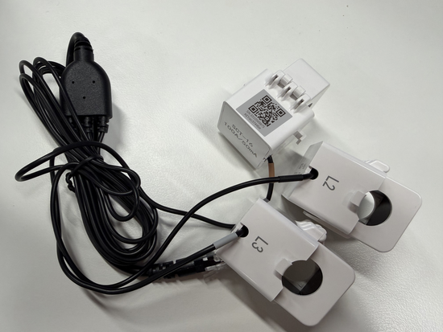
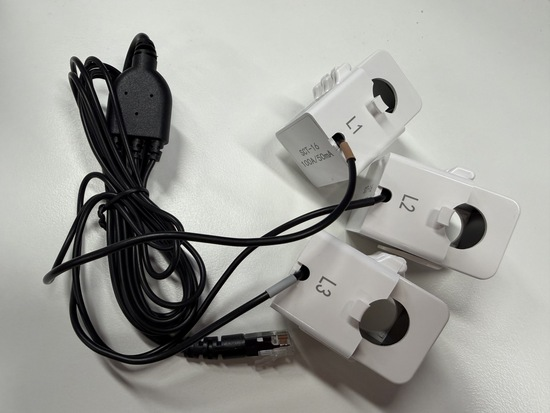
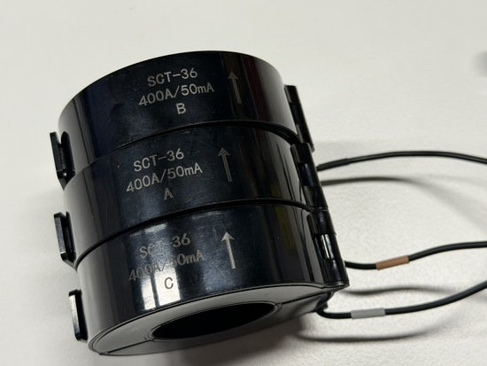
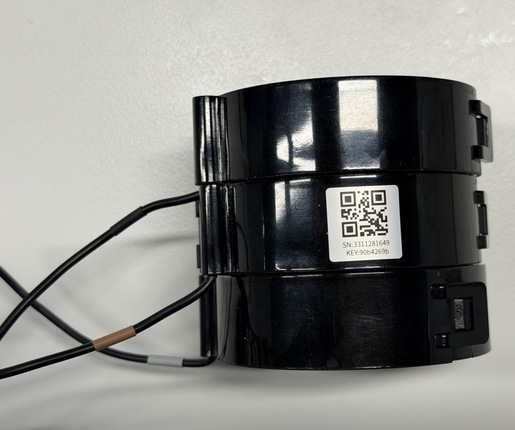

# 配件说明

D5 系列使用开口式电流互感器（CT），精度为 **0.5 级**。单相型号使用 100 A 规格；三相型号对应 100 A 或 400 A 规格，见[参数对比](../parameter-comparison.md)。

| 适用电表 | CT 规格 | 实物图 1 | 实物图 2 |
| --- | --- | --- | --- |
| 单相电表 | 100 A / 50 mA，两种 100 A 外形随机发货 |  |  |
| 三相电表 | 100 A / 50 mA |  |  |
| 三相电表 | 400 A / 50 mA |  |  |
