# 外观、接口与指示灯

## MR1-D5-W 外观

| 左视图 | 主视图 | 右视图 |
| --- | --- | --- |
| 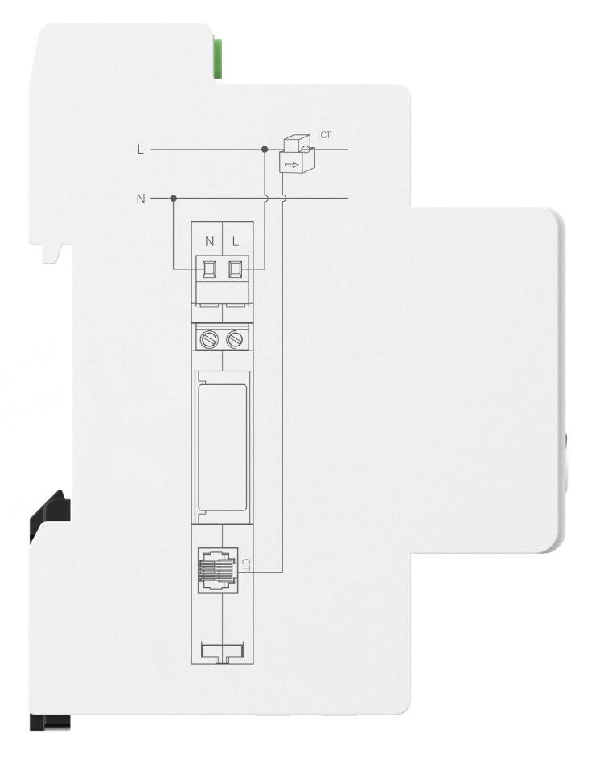 | 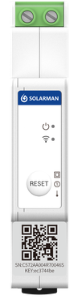 | 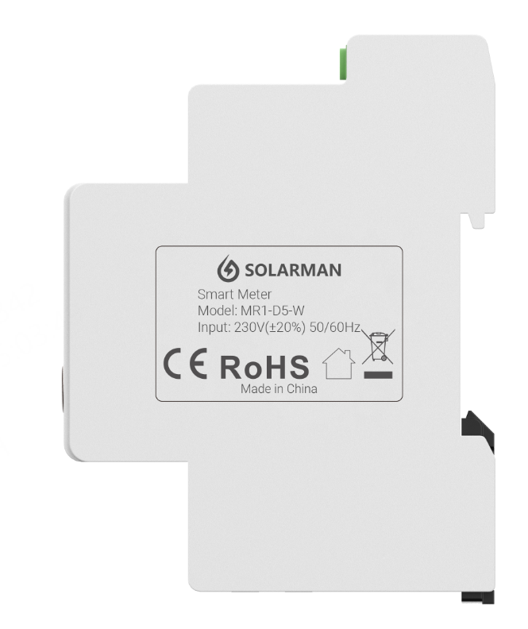 |

| 顶视图 | 后视图 | 底视图 |
| --- | --- | --- |
| 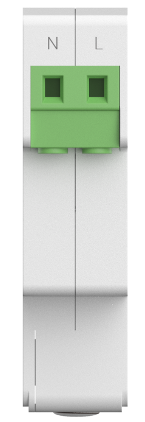 | 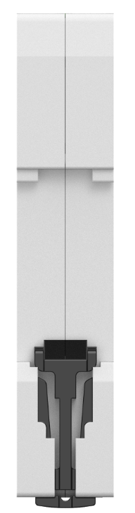 | 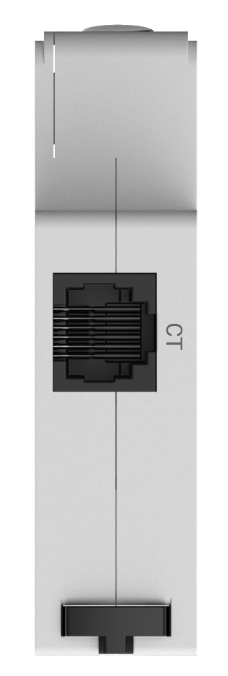 |

## MR1-D5-WR 外观

| 左视图 | 主视图 | 右视图 |
| --- | --- | --- |
| 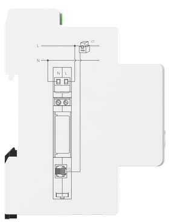 | 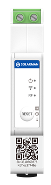 | 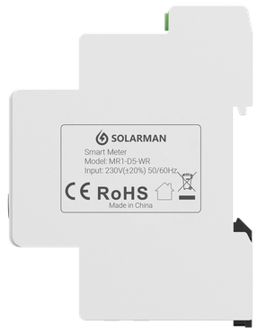 |

| 顶视图 | 后视图 | 底视图 |
| --- | --- | --- |
| 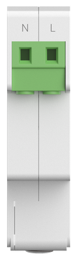 | 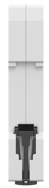 | 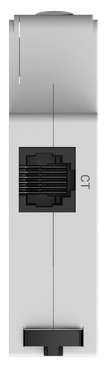 |

## MR3-D5-W 外观

| 左视图 | 主视图 | 右视图 |
| --- | --- | --- |
| 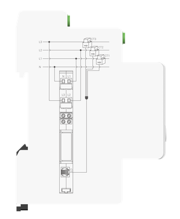 | 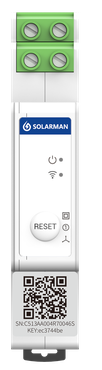 | 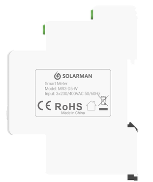 |

| 顶视图 | 后视图 | 底视图 |
| --- | --- | --- |
| 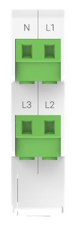 | 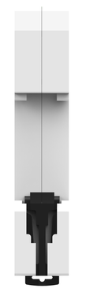 | 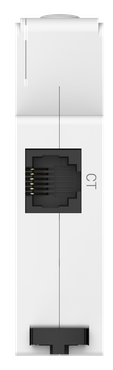 |

## MR3-D5-WR 外观

| 左视图 | 主视图 | 右视图 |
| --- | --- | --- |
| 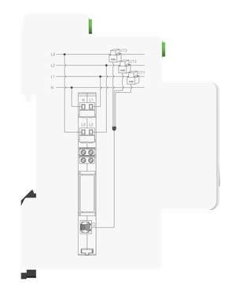 | 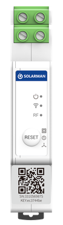 | 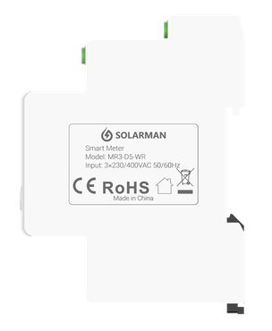 |

| 顶视图 | 后视图 | 底视图 |
| --- | --- | --- |
|  |  |  |

## 接口定义

| 标识 | 说明 | 适用型号 |
| --- | --- | --- |
| N | 零线输入端子。 | 单相、三相型号 |
| L | 单相火线输入端子。 | MR1-D5-W、MR1-D5-WR |
| L1、L2、L3 | 三相火线输入端子。 | MR3-D5-W、MR3-D5-WR |
| CT | 电流互感器接口。 | 单相、三相型号 |

## 指示灯

| 标识 | 指示灯 | 适用型号 | 状态说明 |
| --- | --- | --- | --- |
|  | 电源（红色） | 全部 | 常亮：供电正常。 熄灭：未供电或供电异常。 |
|  | 网络 Wi-Fi（绿色） | 全部 | 常亮：已连接云平台。 每 1 秒闪烁：已连接路由器或已获取 IP 地址。 每 100 ms 快闪：设备正在升级。 熄灭：未连接路由器或未获取 IP 地址。 |
|  | LoRa（绿色） | MR1-D5-WR、MR3-D5-WR | 常亮：LoRa 已连接。 熄灭：LoRa 未连接或未启用。 |

## RESET 按键

| 标识 | 操作 | 状态说明 |
| --- | --- | --- |
|  | 长按 10 秒，恢复出厂设置。 | 所有指示灯常亮 2 秒后恢复正常状态。 |
