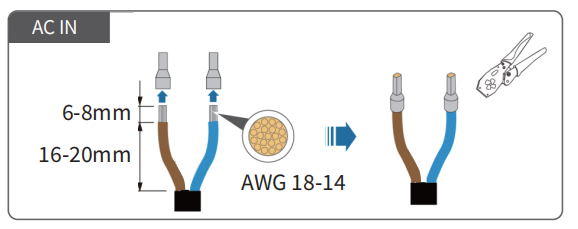
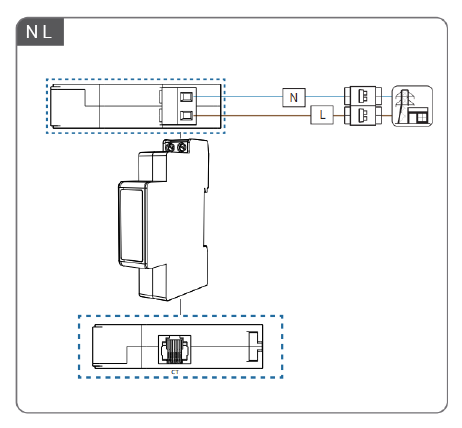
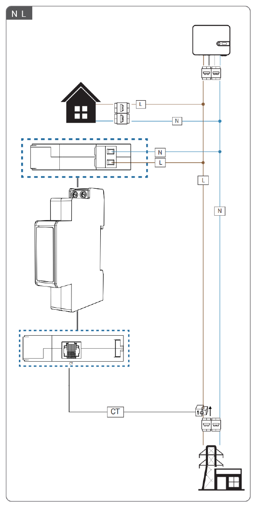
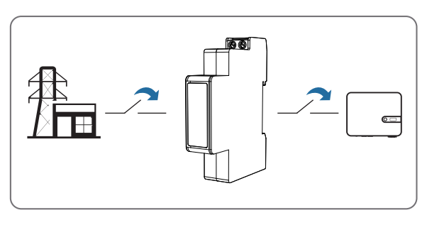

# 单相电表安装接线

适用型号：**MR1-D5-W、MR1-D5-WR**。先完成[安装前准备](wiring.md)。

:::warning 警告
接线前必须完全断电并验明无电。
:::

## 电气接线

1. 使用剥线钳剥除线端 6–8 mm 绝缘层，再使用与线径匹配的端子进行压接。

   

2. 按端子标识，将零线（N）和电源火线（L）分别接入电表。

   

3. 将主火线（L）穿过 CT 孔，确认电源来线方向与 CT 标记的 P1 侧一致，再将 CT 插头接入电表的 CT 端口。

   

4. 完成所有接线并反复确认无误后，方可恢复供电。通电后，观察电表电源指示灯是否常亮，表明电表是否已通电。

   

通电后可参阅 [App 添加设备与配网](app-usage.md)。
