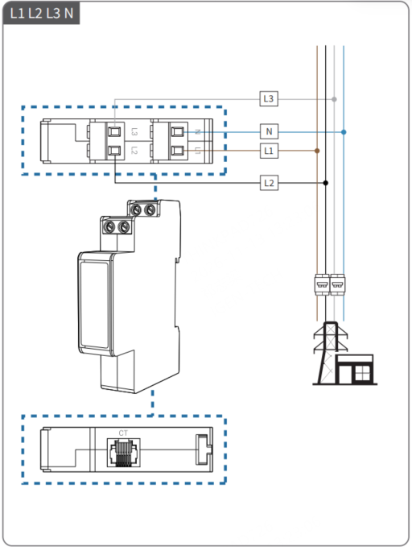
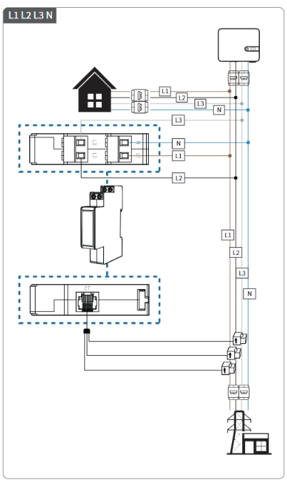
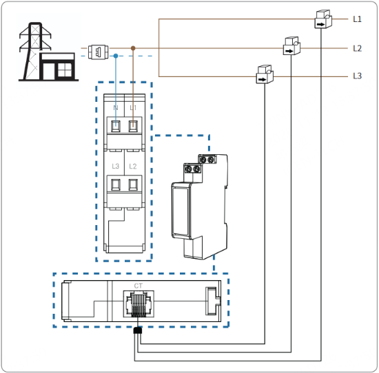
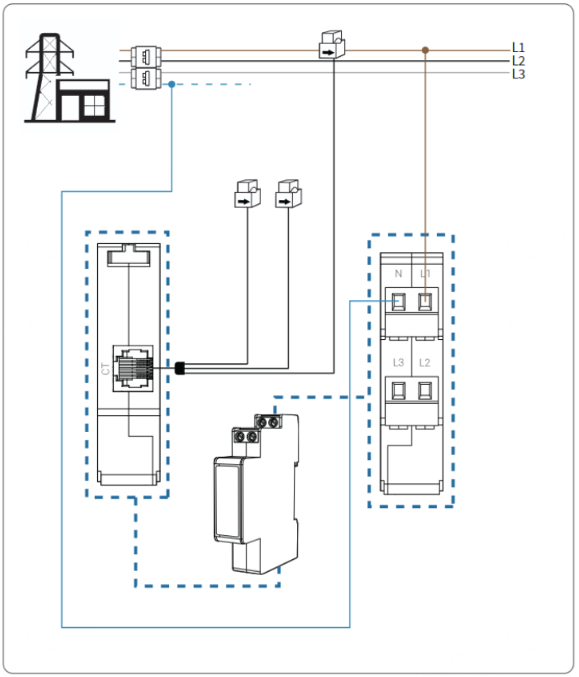
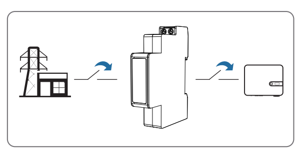

# 三相电表安装接线

适用型号：**MR3-D5-W、MR3-D5-WR**。先完成[安装前准备](wiring.md)。

:::warning 警告
接线前必须完全断电并验明无电。以下接线图对应不同检测场景，安装前请由专业人员确认适用图示。
:::

## 标准三相接线

1. 使用剥线钳剥除线端 6–8 mm 绝缘层，再使用与线径匹配的端子进行压接。
2. 按端子标识，将零线（N）和三相火线（L1、L2、L3）分别接入电表。

   

3. 按标准三相接线图安装 CT，核对 CT 与火线的相别，并使电源来线方向与 CT 标记的 P1 侧一致。将 CT 插头接入电表的 CT 端口。

   

## 其他检测场景

以下两种场景各有独立的接线图。

### 单相系统三通道负载检测

### 三相系统单相检测

## 通电检查

完成所有接线并反复确认无误后，方可恢复供电。通电后，观察电表电源指示灯是否常亮，表明电表是否已通电。

通电后可参阅 [App 添加设备与配网](app-usage.md)。
