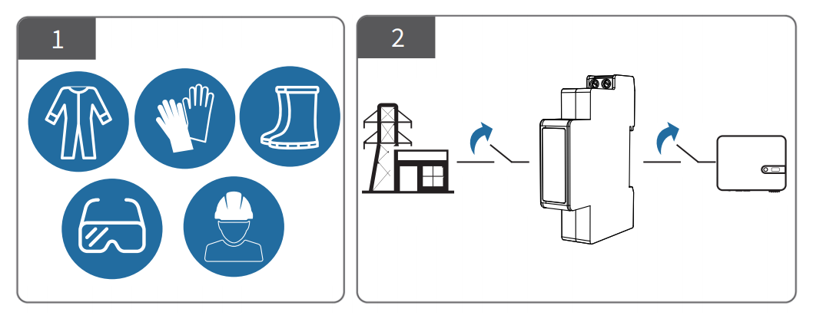
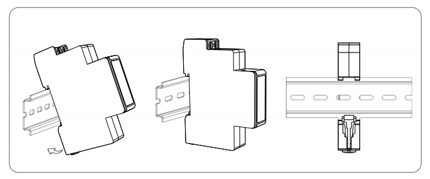

# 安装前准备

适用型号：MR1-D5-W、MR1-D5-WR、MR3-D5-W、MR3-D5-WR。

## 人员与防护

安装须由有经验的电工或专业人员执行。安装前阅读[安全注意事项](../safety/safety-instructions.md)，确认已理解接线要求，并穿戴符合相关安全标准的专用防护用具。

:::warning 警告
所有安装和接线操作必须在完全断电并验明无电后进行。严禁带电安装或接线。
:::

## 机械安装

1. 根据[电表尺寸](../overview/product-structure.md)，在配电箱的 35 mm 标准 DIN 导轨上选择安装位置，预留接线和维护空间。配电箱内应配备适配的浪涌保护器（SPD）。
2. 将电表背部卡槽对准导轨上沿，向下按压，直到电表底部卡扣可靠锁紧在导轨上。

## 选择接线章节

- MR1-D5-W、MR1-D5-WR：[单相电表安装接线](single-phase-wiring.md)。
- MR3-D5-W、MR3-D5-WR：[三相电表安装接线](three-phase-wiring.md)。
